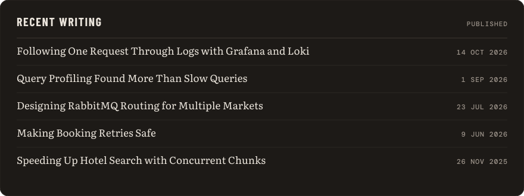

<b>💼 Workday</b>

 

I work on the backend behind ShareTrip's bookings, payments and pricing. Search must be fast, every markup and discount must match, and every booking and payment must be traceable. When something goes wrong, I go to the evidence first: query plans, logs and traces.

🏆 Champion, Banglalink SDG Hackathon: Code for a Cause 2.0

[Read them on my blog →](https://thedrowsywinger.github.io/blog/)

<b>⚽ Matchday</b>

 

Away from the keyboard, my life is about three things: family, friends and football. I see my tools as a team, and this is the side I would pick.

Data at the back, the plumbing in midfield, NestJS up front. AI agents (Claude Code, Codex, T3 Code) play false 9: they drop deep and set up the finish. The manager picks the team and owns the result. [How I work with AI agents →](https://thedrowsywinger.github.io/agents.html)

---

[Website](https://thedrowsywinger.github.io/) · [LinkedIn](https://www.linkedin.com/in/abdullah-md-sarwar/) · [X](https://x.com/thedrowsywinger) · [abdullah.md.sarwar@gmail.com](mailto:abdullah.md.sarwar@gmail.com)
